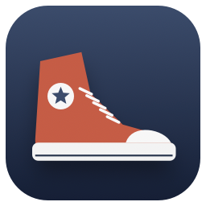

<p align="center">
  
</p>

# Converse

A Mac app that manages multiple conversations with Muse, Claude Code, and Codex: the immediacy of a shell with a normal, selectable Mac text window. You "converse" (sorry) with the coding tools, and they can also message each other.  You might like it if...

* You really don't like pretending you're using a CRT from the 1970s.
* You use multiple coding tools, or multiple accounts with one coding agent.
* You have noticed how hard it is to build a switchboard where these tools talk to each other
* You hate looking at raw markdown

It's a bit "opinionated" to match how I work.  Feel free to rip it off and make any changes you like.

100% vibe-coded.

## Download

[Download the latest Mac preview](https://github.com/richardkaufmann/converse/releases/latest). Unzip, drag **Converse.app** into **Applications**, and open it. The universal download targets **macOS 14 or later**, on **Apple Silicon and Intel**. It is tested on an Apple Silicon Mac; older macOS versions and Intel hardware have not been tested directly.

Version **0.4.4** and later releases are **Developer ID signed and notarized by Apple**. macOS shows its normal first-open confirmation. Earlier previews were ad-hoc signed. Install and sign in to Muse, Claude Code, or Codex separately, then set a valid working directory in Converse Settings. No accounts, credentials or conversations are included in the download. You only need the CLIs you intend to use.

## First launch

Setup opens automatically for a new installation:

1. Choose one or more assistants, follow the official CLI installation links, and use **Check CLI** to verify installation. Choose an existing project folder (or keep `~` for your home folder).
2. Reuse an existing CLI login or use **Sign in…** to open the selected CLI’s login flow in Terminal. Add another named Codex or Claude account for an independent sign-in. Muse reuses its CLI login. Credentials stay in the CLI’s stores.
3. Choose an assistant and account, then **Create session**. Creating a session sends no prompt. Type at the bottom and press Return to begin.

Use **+** for more sessions, **Settings → Models & sessions** for additional sign-ins, and **Converse → Setup** to revisit setup. **Set up later** skips the guide. Existing users keep their saved accounts, commands, sessions and drafts; upgrades do not rerun first-launch setup or replace local settings. CLI version checks confirm installation, not sign-in or subscription access.

## Use

The sidebar has one heading per assistant: **Claude**, **Codex**, and **Muse**. All its sessions appear beneath it, regardless of login or older launch-configuration names. Click **+**, choose a session name and working folder, then choose an existing login or **New login…**. A new login opens authentication in Terminal; finish there and return. Settings (**⌘,**) follows the same model → session → login structure, with advanced CLI configuration below each model.

- **Return** sends, or queues the draft while a turn is active. Queue rows have **Inject now** to interrupt and send that message next. **Inject all** interrupts and sends the entire queue together in order, preserving attachments and the current draft. Escape has no send or interrupt binding. **⌘Return** inserts a newline; Shift-Return also works. These keys have the same meaning for all assistants.
- Queued messages appear above the transcript, with Pause/Resume, Edit, and Clear controls. Stop pauses the queue; failures pause it too. Queued text and attachments survive relaunch, paused until you resume. You can keep editing a separate draft while the queue runs.
- **Inject now** immediately shows **Interrupting — your queued prompt is next**, then confirms when the prompt starts. Repeated clicks while stopping do not send additional interrupts. Remote queue controls wait for a home acknowledgment; stale items and blocked injections show a reason instead of false success. **Check home** resolves an outstanding request without submitting it again.
- Draft image previews have a small **×** in the upper-right corner. Click or tap it to remove that image before sending; your text and other images stay in place. This also works in remote panes and on iPad.
- Muse turns wait for the previous local host to exit before starting queued input. If another host owns the session, Converse holds the unsubmitted prompt in a paused queue and shows **Session in use · input held**. Close that host, then use **Resume queue** or **Inject now**. Newer draft text and attachments stay intact.
- Your draft is **blue**. Submitted input becomes *italic* in the default system text color, enclosed by subtle separator rules. The app follows macOS light/dark appearance.
- Assistant Markdown renders natively: headings, bold/italic text, lists, inline and fenced code, block quotes, clickable links, and pipe tables. Successful tool chatter is hidden; the assistant's answer remains visible. Tool failures remain visible, and Muse's workspace root/trust diagnostics are hidden.
- Gaps of ten seconds or more before answer text get grey markers such as `[10 sec]` or `[10.5 minutes]`. Timing starts at Send, then follows visible answer text; hidden tool events do not reset it.
- Right-click in the transcript for **Copy this prompt** or **Copy this response**, using the exchange under the pointer. Rich-text targets receive formatted text (RTF/HTML), including tables and links; plain-text targets receive the original Markdown. Copies omit delay markers.
- Paste screenshots with **⌘V**, or attach images with the paperclip. Attachments are saved as PNG files and supplied to the assistant.
- Images returned by an assistant appear in the conversation and travel to remote panes. Converse asks the assistant to save output images in its session output folder and return Markdown image references. Local output images and public HTTPS image URLs are copied into bounded PNG attachments on the session’s home computer and travel to viewers. HTTPS downloads use no saved cookies or credentials, enforce byte/pixel limits, and reject private-network destinations and redirects. While loading, or if loading fails, a web image’s caption remains a clickable link. Code examples and paths outside the permitted output folders are not imported.
- The **message numbers** checkbox controls the transcript gutter. Each visible message receives one number in a single sequence: prompt numbers are blue and response numbers are grey. Wrapped lines, paragraphs, images, and the editable draft do not add numbers. Numbers from Mac homes continue through history paging. The checkbox defaults on and remembers your choice.
- Input stays at the bottom; the window follows typing. Click blank space below the transcript to focus the input line. The editable document fills the window, including tall windows. Older text stays selectable and protected from edits.
- Scrolling up pauses following. **Jump to latest** shows the number of new output updates and immediately returns to the tail. Following also resumes near the bottom or after five seconds without input or scrolling; it never resumes while text is selected. New output does not reset that idle period.
- Remote drafts identify the home device and version they were restored from. If a lease refresh supplies a different draft while you have unsent edits, choose **Keep my draft** or **Use home draft**; Converse preserves your local text and images until you choose.

The sidebar gutter can be dragged down to 160 points wide. Below 360 points, the model column and its header disappear; narrowing further truncates conversation titles with an ellipsis while keeping the activity indicator and P/1/2/3/X buttons visible. The full model and title remain in row hover details.

Click the **pin** to the left of **Conversation** to hide the sidebar. A small restore pin stays at the top-left of the conversation area. Click it again to restore your previous sidebar width, constrained by the space available. Each window has its own pin state. Hiding the sidebar leaves its displayed conversations and work running.

**Converse → Setup…** reopens account and session setup. **Help → Converse Help…** opens searchable, selectable documentation built from this README and bundled with the app for offline use. Search matches topic titles and article text and highlights matches. Command-F focuses Help search when the Help window is active.

Prompts and responses have a blank line between them. In light mode prompt line-number blocks have a light blue background; responses have white. In dark mode the gutter is black, with blue prompt numbers and white response numbers. JSON blobs and switchboard/tell traffic use orange.

Each sidebar row shows a spinning rainbow beachball while the assistant is working (blank when idle or waiting for you), the conversation title, its model, and **P 1 2 3 X**. Hover over the row for account email, profile, model, effort, access, state, current window/pane, usage, quota, directory, queued input, draft/attachment counts and session IDs. Identity comes from the account's CLI: Codex account metadata, Claude initialization/auth status, or Muse's non-secret auth identity fields. The observation time is included; missing identity and probe failures are stated explicitly. Hover refreshes stale metadata without submitting a model prompt.

- **P** parks the conversation: no right pane displays it, and active work continues.
- **1 / 2 / 3** move it into that pane in this window. Each pane holds one conversation; its previous occupant is parked. Moving from another window vacates the original pane immediately.
- **X** asks before closing the conversation, stopping active work and removing it from every sidebar. A recovery snapshot retains transcript, draft and attachments; **File → Restore Closed Conversation** restores it. Closing a conversation leaves the window open and its pane empty.

Hover details appear in a native scrollable panel after a short pause over any part of a session row. Moving into the panel keeps it open so its text can be selected and copied; moving away closes it.

The selected P/1/2/3 button has a green background and white text. Other buttons have white backgrounds, black text and faint borders. X turns dark red while its confirmation is open. A conversation displayed elsewhere shows P in this window; hover gives its exact location, and its context menu can bring the owning window forward. P always parks it globally.

**File → New Window** (**⌘N**) opens a separate window with the same complete sidebar and up to three independently resizable panes on the right. Empty slots take no space; a numbered header identifies each visible pane, with its provider’s logo, a larger session title and a **P** button to park it. New windows start empty. Right-click the window name in the title bar to rename it; the **Window** menu uses these names to bring windows forward. Names are unique among open windows. Closing a window parks all its conversations and leaves their work running. Quit warns about active commands and any agents hosted on this Mac, even paused agents: exiting makes them unreachable and stops their loops until Converse restarts. Confirmed quit preserves configured loop settings for restart; Keep Running changes nothing. Pane assignments belong to open windows; after relaunch, choose 1, 2 or 3 to display saved conversations again.

Adding or removing a visible pane evenly redistributes the conversation widths. Adding a pane caps an overly wide sidebar just below the model-column threshold without expanding a sidebar you deliberately made narrow; removing a pane leaves it alone when space permits. Replacing a conversation in an existing pane keeps the gutter positions. Resizing the window preserves your session-pane proportions, temporarily clamps panes at readable minimums, and restores those proportions when space returns. The sidebar scales down in smaller windows and returns toward your chosen width as the window grows. Gutters remain adjustable; the window grows only if needed to fit the minimum sidebar and session widths.

Right-click a conversation for Configure, pane moves, Park, Show in its owning window, or Close. Configure is disabled while work runs. Session titles update immediately everywhere after Save. Changing a session’s working folder applies to its next CLI turn, retaining its login and conversation ID; no new conversation is needed. The current working folder is included in the next prompt’s local context. Missing folders are rejected before saving. Assistant headers retain Configure and New Session actions. Conversations, drafts, attachments and last-observed account identities survive relaunches. Bold assistant names indicate that conversations exist.

A compact bottom status line shows the current state, model, reasoning effort, access setting, and last-turn input/output token counts. Opening a Muse session queries `muse serve` through read-only `session/read` and `usage/read` calls. No turn is submitted and the session is not resumed or attached. The app combines retained session metadata and the session log with saved settings: the model and access profile are session-derived, while a saved effort without a retained override is explicitly labeled `(config)`. The log supplies last-turn and cumulative session token counts across relaunches. The refresh button queries again. Model, effort and access dropdowns work for all three assistants. Codex queries its app server for its catalog, effective configuration and retained thread metadata; Claude uses its prompt-free SDK initialization catalog and retained transcript. Effort menus use the selected model’s reported supported levels. Custom model IDs and effort levels are also available; the CLI validates custom choices. Click the model, effort or access value to choose a conversation setting. Existing sessions use Muse's durable setters; new conversations retain choices for their first turn. Controls remain editable during active work and metadata refresh; they briefly disable while a setting transaction awaits acknowledgment. Global settings and other conversations are unchanged. Values persist and also refresh after turns. For subscription quota, Converse also runs the installed CLI's `/usage` command in an invisible, ephemeral terminal (`--no-session-log`), with no model prompt. This retrieves current-window and weekly percentages and reset times. It refreshes on open (cached for five minutes), `/usage`, or the refresh button. The displayed timestamp identifies the CLI observation when available, otherwise the query time. Failures are shown explicitly; token counts are never presented as remaining quota.

The Mac's local time zone and send time are supplied as context to the assistant, and the child process receives the matching `TZ`. Local time is preferred unless another time zone is requested.

## Converse Groups

Choose **Converse → Converse Groups…**, or **Converse Groups** below the sidebar sessions. **Create Group** gives this device a named group. On another device, find that group and press **Join**. Groups and their discovered devices are listed together; group names must be unique among the groups this device can see.

The joiner immediately sees an eight-part verification number. All current group members see its request; any one presses **Review** to reveal the same number. Compare **all eight parts**, then press **Pair** on both the joiner and that reviewing device. Admission does not take a session automatically. Join-by-address uses the same flow for VPN connections where discovery is unavailable.

Only group members see the additional **Group** section and remote devices/sessions in the sidebar. Sessions stay organized under their home device. Use **1**, **2**, or **3** to move a session’s display here; its tools, logins and working folder stay home. **P** parks the display. Home work continues when the viewer disconnects; take the session again after reconnecting. Uncertain sends require **Check home** rather than automatic replay.

Each device belongs to at most one group. A canceled join keeps the previous group. Creating a group or successfully joining another moves **this device only**; groups never merge. **Leave** parks remote panes and preserves local sessions. Any member can **Dissolve** the group after confirmation; offline devices learn that on reconnect. Group membership grants history access and tool control under home logins, and every member can admit other devices, so admit only devices you trust.

Existing paired devices migrate into a default **Converse Group**, preserving their logins and sessions. Update every device to a groups-capable build. Names are display labels; separate LANs may independently create identically named groups, which retain distinct internal identities. [Protocol and verification details](docs/groups.md).

## Agents and project scoreboards

Mac agents are **sessions with initiative**: talk to them in a normal session pane, or let a bounded loop and opt-in file events initiate work. Use **New agent…** below the sidebar sessions or **Converse → New Agent…**. An agent appears under its execution home in Group, alongside its other sessions. It starts paused with no sessions selected. This rollout is **Mac-only**; Windows and iPad agent creation/control are deferred.

Choose this Mac or a capable online Mac in the current group as the home. The home runs the agent while Converse is open. Credentials, execution and its optional scoreboard window stay there when you take the transcript on another Mac. Leaving/changing groups removes old-group visibility and routing; queued messages are checked again before execution.

Open **Agent Setup** on the home to enter a [Meta Model API](https://dev.meta.ai/docs/overview) key, with optional GitHub token and Discord webhook. **Test key** makes one short request to the selected model without sending session history; it tests an entered replacement or the saved key. Credentials live only in that Mac’s Keychain and are shared by its agents. Remote Agent Setup edits settings without receiving keys. Blank credential fields retain saved values; **Remove saved** explicitly deletes one. Remote creation retries use a durable command identity, so uncertain retries do not create a second agent.

Select the local or same-group sessions the agent may read/message. For the demo steward, explicitly select Converse Development and MuseConverse and explain your project and acceptance criteria in its conversation. Scope starts empty. Same-group evidence is requested from its home without taking a pane; unsent drafts and stored API credentials are excluded. Right-click for **Run once**, **Agent Setup**, **Show scoreboard** or **Clear attention**. **Start talking!** starts a hands-free conversation on this Mac. After detecting sustained sound, a 1½-second quiet pause sends your question. The microphone is off during transcription, the agent’s work, and its spoken answer; it reopens after playback ends. **Stop talking** stops listening/playback without cancelling a question already sent. Existing typed drafts and images stay intact. Automatic loops and queued messages wait while you talk. Initial silence stops after 20 seconds; each recording is capped at one minute, and a conversation at 20 spoken turns. Silence detection uses microphone level, so a noisy room may need **Dictate…** instead. Parking the pane or quitting ends the conversation.

**Dictate…** opens a nonmodal recorder: Record, Stop & transcribe, then review and Insert into draft. Up to 60 seconds of audio goes to Meta Voice using the saved Meta key. It never submits text automatically. Permission denial or transcription failure shows a retryable status; Cancel stops recording and removes temporary audio. Spoken replies use bounded pace/pitch settings from emotional intent.

Agent requests use explicit low reasoning effort and an 8192-token budget shared by reasoning and visible output. An incomplete response never applies actions; token exhaustion, other termination and authentication errors have distinct notices. Safe model/status/token metadata is saved in `Agents/<session-id>/last-response.json`, without request contents, raw output, reasoning text or keys.

The interval is at least 60 seconds. Scheduled ticks, incoming agent tells, Run once and file events share the autonomous run allowance; direct human chat remains available after it is exhausted. Runs never overlap or overwrite a separately edited draft. A failure pauses the loop and raises yellow attention. Closed apps do not run agents. Relaunch schedules the next interval without replaying missed ticks. Stale settings forms cannot restore runs that were spent while the form was open: use **Reload settings** before saving again.

Optional file events use `Agents/<session-id>/Inbox/*.json` under the home’s Converse application-data folder (the full path is shown in Agent Setup). Enable file input explicitly. A regular, non-symlink file under 16 KB contains `{"id":"event-UUID","text":"Your event, at most 8000 UTF-8 bytes"}`. The event ID and pending input are saved before the file is consumed; duplicate event IDs do not run twice. Invalid input pauses file ingestion with an attention notice. This adds no inbound webhook server or autonomous shell access.

GitHub is optional: leave Repository blank for a general-purpose agent. Such agents skip GitHub requests and show their update and optional art without repository metrics or a GitHub setup warning. Agents can use Meta’s built-in web search for current facts and news; turn it off in Agent Setup if unwanted. Each run allows at most four hosted search calls. Source links come from API results/citations, not invented URLs. With a repository configured, the scoreboard measures stars, open PRs, open issues, open issues labeled `bug`, issue/PR conversation comments, release-asset downloads and, with an authorized GitHub token, unique repository visitors over 14 days. **Actual app users are not measured.** Unavailable values remain unavailable; PRs are excluded from issue/bug totals. Public polling may hit GitHub’s unauthenticated limit.

For general-purpose agents, the model chooses scoreboard cards from your instructions (for example price, change and volume), with a short news/status summary. External metric cards require a source URL returned by that run’s search; unsupported values show Unavailable. Cards display source-reported observation time separately from retrieval time: a prior close or delayed quote is not advertised as a live tick. Search-backed values are model-extracted, not an exchange-grade market feed. Native and exported scoreboards retain clickable sources.

Optional [Muse Image](https://dev.meta.ai/docs/image-generation) art follows your requested subject, humor and logos, using scoreboard sentiment or measured repository changes: new bugs can suggest cinematic horror; zero bugs can become a peaceful chocolate orchard. The scoreboard keeps generated art in a header and measured counts on solid, readable cards. When repository data is unavailable, it shows one GitHub setup explanation rather than empty metric tiles. Art refreshes on mood change or after an hour, at most once per run. **Scoreboard → Export widget** saves a portable HTML snapshot with embedded art, no scripts or network dependencies. Latest `widget.html` and `metrics.json` live under Application Support/Converse/Agents/<session-id>/. Generated art also uses ordinary inline-image transport. Discord is off until enabled and suppresses mentions. Agent Setup includes **Test key** for Meta, **Test GitHub** for token/repository/traffic access, and **Send test** for Discord. Tests use an entered replacement or the saved credential without saving changes. Discord posts one labeled test message with no session content or mentions; GitHub tests are read-only.

On Mac, agents show a yellow caution badge in the sidebar whenever attention is requested, including while displayed in a pane. Hover puts that message first. The beachball means a check or prompt is actively running; a green loop symbol means periodic checks are enabled and waiting. The agent footer shows Thinking/Idle, loop state, interval, next check, and remaining automatic runs. **Loop…** opens controls for automatic checks, interval, remaining turns, and scoreboard refresh every N scheduled loops (default 1). Enabling the loop schedules its first check one interval later. **Run once** queues a check and forces a scoreboard refresh without enabling the periodic loop. Turning the loop off leaves a current run alone. Between scoreboard refreshes, scheduled checks still produce conversation reports using timestamped cached repository metrics. Held queues still require **Resume queue**. Watched-session summaries include timestamped host activity so an active session is distinguished from historical unresolved bugs.

### Messaging between Macs

`list-sessions` includes local sessions and remote sessions from the current group, labeled with their execution home and online/messaging state. Copy the directory’s exact ID: local UUIDs remain supported; remote IDs are `homeDeviceID/sessionUUID`. Both homes need this update for cross-device messaging. Older/unsupported homes are listed with messaging unavailable.

Tells do not acquire a display lease. The recipient must have session messaging enabled on its home; ordinary tells preserve paused queues and drafts. Acceptance means **persisted in the recipient queue**, not read or answered. Duplicate delivery IDs do not enqueue twice. Offline/out-of-group targets fail visibly; an unconfirmed send is not automatically replayed. See [the wire contract](docs/participant-control.md) and [agent design](docs/agents.md).

## Export transcripts

Choose **File → Export…**. In the standard Mac save dialog, check one, several, or all sessions; choose **Interleaved by time** or **One after the other**, **Prompts**, **Responses**, or **Both**, and whether to include line numbers. The export is a snapshot of submitted messages when the dialog opens; drafts, tool activity, and account configuration are excluded.

Choose **HTML** for one portable file with formatted headings, emphasis, code, tables, links, and embedded attachment images. Open it in a browser to read or print. Choose **Text** for a UTF-8 `.txt` file preserving original Markdown and listing attached image filenames; line numbers are disabled for Text. New messages retain their creation times. Older messages without recorded timestamps are labeled **Time unavailable** and appear after timed messages in their original session order when interleaved.

## Local slash commands

These are handled by Converse without sending a prompt or spending model tokens:

| Command | Behavior |
| --- | --- |
| `/model`, `/models` | Read model, effort, access and their sources |
| `/usage` | Read last-turn and session-total token usage, plus any observed account quota |
| `/status` | Refresh and display all session details |
| `/stop` | Interrupt the current turn |
| `/login` | Choose an existing login, create a new login, or sign in again; uses the same picker as session creation |
| `/help` | Show local command help |

Muse queries run automatically when a conversation is opened. Read-only metadata commands do not change model, permissions or effort. `/usage` additionally invokes the built-in CLI usage view to fetch subscription quota; it never submits a model request. The status pickers, by contrast, explicitly update the selected conversation's model, effort or access profile. Muse uses its durable setters. Codex and Claude save per-conversation overrides and pass them on each subsequent turn, including resumed turns. CLI defaults are labeled when the CLI does not report a resolved effort. Claude and Codex also refresh their model catalogs and account/session metadata without submitting a model prompt. These commands do not implement the full CLI slash-command menus. Unrecognized commands remain ordinary prompts.

## Model, effort and access options

Catalogs come from the installed CLI and selected login, rather than a fixed list of model names. Codex includes hidden catalog rows and follows pagination; availability still depends on the account. Effort menus use each model’s reported supported levels. Custom model/effort entries remain available.

| Assistant | Access controls |
| --- | --- |
| Claude | Manual, Accept edits, Auto, Plan, Don’t ask (deny unapproved), Bypass permissions |
| Codex | Read-only, Workspace write, Full access; independent approval policy: CLI default, Never, On request, Untrusted |
| Muse | The host’s available permission profiles; current built-ins include read-only, ask-me, auto-review, unrestricted |

**Claude’s Don’t ask denies actions needing approval. Bypass permissions is the separate mode for skipping permission checks.** Converse passes the selected mode to every turn, including resumed turns. CLI/organization restrictions still apply. Claude and Codex run headlessly here, so terminal approval dialogs are not embedded. Muse’s host supplies native approval choices. Claude/Codex model, effort and access menus can return to CLI defaults.

Sources checked against the installed CLI help and schemas: [Claude permission modes](https://code.claude.com/docs/en/permission-modes), [Codex command reference](https://learn.chatgpt.com/docs/developer-commands), and Muse’s offline MSP schema (`muse schema generate-json-schema`). Muse’s reported effort variants and profile availability take precedence over its broader CLI vocabulary.

## Accounts

Settings → Models & sessions groups sessions and saved logins under their model. Click the login identity in the conversation footer, type **/login**, or use **Login…** in Settings. Choosing an existing login binds it to this session without changing that login or any other session. Authenticating another account always stages a fresh isolated login for the selected session. The session keeps its ID, history, draft, attachments and retained CLI transcript; only that conversation’s transcript is copied to the selected CLI store, never credentials or other conversations. Missing or conflicting context leaves the binding unchanged with an error. Closing windows keeps active work alive.

Default accounts use the standard CLI stores (`~/.codex` and `~/.claude`); Muse reuses its current CLI sign-in. Add more named Codex or Claude accounts in Settings. Each additional account gets a separate configuration directory under Converse’s local data folder. Use **Sign in…** for each account, complete the official CLI flow in Terminal/browser, then return to Converse. Claude desktop accounts are separate from Claude Code accounts. No account names, credentials or configuration are bundled with the app.

Click a conversation’s login identity or type **/login** to open its login picker. **Sign in to another account for this session** opens authentication in a fresh private CLI configuration folder. Finish in Terminal/browser, then return to Converse and retry your message or resume its held queue. Authentication cannot overwrite a saved login used by another session. Signing into one session does not block or pause peers. A conversation’s title does not select its login.

Claude’s normal installed CLI login is kept distinct from an explicit `CLAUDE_CONFIG_DIR` store, even when both refer to `~/.claude`: their macOS authentication namespaces can differ. Both are selectable without copying credentials or requiring another sign-in when they are already authenticated.

Additional Codex and Claude accounts can be added, renamed, or pointed at existing CLI stores. New conversations take a snapshot of the account path. Changes in Settings leave existing conversations on their original paths. Account-directory overrides are applied after shell startup, and inherited API/OAuth token environment overrides are removed for explicitly selected accounts so they cannot silently use another account. The CLIs retain responsibility for authentication, keychain storage and permissions.

Each distributed preview advances its visible patch version and build number (for example, **0.5.1 (26)** → **0.5.2 (27)**). Check **Converse → About Converse** on Mac or the **…** menu on iPad to identify the installed update. `VERSION.json` is the shared version source for both apps.

## Build and run

This preview is built and tested on an Apple Silicon Mac using Apple's Command Line Tools and the installed macOS SDK, targeting macOS 14. No third-party libraries or Xcode project are required.

```sh
./build.sh
open .build/Converse.app
```

`./release.sh` builds both CPU architectures, signs with Developer ID, notarizes with Apple, staples the ticket, checks Gatekeeper, and packages the downloadable ZIP under `.build/release/`. It requires a valid **Developer ID Application** identity and a Keychain notarization profile named `ConverseNotary` (override with `CONVERSE_NOTARY_PROFILE`). See [signed releases](docs/signed-releases.md) for the one-time setup and release checks. A local ad-hoc build cannot pass the release gates.

**Building or publishing does not update an installed copy.** Run `./install.sh` to install the verified build into `~/Applications/Converse.app`, or pass the exact app path you normally launch: `./install.sh /path/to/Converse.app`. For an installation outside protected folders, if that copy is running, installation waits for it to quit, retains the previous bundle as a backup, and replaces the app at that same path. Running copies inside Documents, Desktop or Downloads cannot be reliably updated by the background helper because macOS gives it a different privacy identity; the installer rejects that queue request and recommends installing into `~/Applications/Converse.app`. Quit the old app and open the new Applications copy explicitly; an old Dock shortcut may still target the old copy. Wait a few seconds after quitting before reopening. Conversations and credentials are not touched. The script prints a status-file path; check it for `INSTALLED` before claiming the installed copy is current. This is a local developer installation helper, not an automatic release updater.

Keep your checkout outside Documents, Desktop and Downloads (for example, `~/Developer/Converse`) to avoid macOS protected-folder prompts during development. Builds go into `.build`; use `CONVERSE_APP_OUTPUT=/path/to/Converse.app` to choose another destination. The build refuses to replace a running app because changing an ad-hoc signature can invalidate its privacy permissions.

The build generates the sneaker artwork with a plain circular badge and creates `.build/Converse.app`. When exactly one valid Developer ID Application identity is installed, builds use it automatically with hardened runtime and a secure timestamp. If several are installed, select one with `CONVERSE_SIGN_IDENTITY` (certificate SHA-1 or full name). Without a Developer ID identity, local builds use an ad-hoc signature; `CONVERSE_SIGN_IDENTITY=-` explicitly requests one. Local builds are not automatically notarized. Generated app and icon bundles are excluded from Git; their source is included.

Install and authenticate the assistant CLIs separately. Configure each entry with the matching adapter; Converse uses Muse’s interactive MSP host and the other adapters’ headless modes. Command lines run through your login shell. Homebrew and `~/.local/bin` are included in the executable search path.

## Check

With Muse installed:

```sh
./test.sh
```

For provider-only checks without a macOS GUI session, use `./test.sh --providers-only`. They validate shared multi-window placement, displacement/parking, window naming/closing, hover identity and persistence, catalogs, setting arguments, all three interruption paths, exact resumption, queue ordering and recovery, failure handling, account environment separation, and archive compatibility using offline peers. A live read-only smoke query is available with `.build/Converse.app/Contents/MacOS/Converse --probe-provider-status codex /path/to/codex-home` (or `claude /path/to/claude-config`). Neither submits a model prompt. If iconutil is unavailable in the build environment, `CONVERSE_SKIP_ICON_BUILD=1 ./build.sh` reuses an existing icon bundle.

The checks use isolated temporary data and Muse's offline echo provider. They cover real Muse execution and session resumption, prompt quoting, persistence, image creation and image-only clipboard paste validation, interactive Muse completion and approval/question round trips, text editing and styling, Command-Return, input blocks, output cleanup, elapsed-time markers, clickable links, and Claude/Codex protocol fixtures. Claude and Codex checks do not make paid requests.

## How it works

- **Muse:** `muse serve` over bidirectional JSON-RPC (MSP), resuming the retained session and using `turn/start`. Approval requests and questions are displayed above the transcript; decisions and answers go back on the same connection.
- **Claude:** print mode with streaming JSON, resuming its exact session ID.
- **Codex:** `codex exec --json`, resuming the returned thread ID.

Each Muse turn opens an interactive host, which closes after the authoritative `turn/completed` event; Claude and Codex launch headless processes. Muse interruption uses `turn/interrupt`. If no completion arrives within five seconds, Converse stops that session’s local host, escalates to a forced exit after another five seconds if needed, and waits for the host to exit before resuming. Stop holds queued messages; Inject resumes them in the saved conversation without changing the current draft. Claude and Codex receive SIGINT, with SIGTERM after five seconds if needed; Converse waits for the old process and output stream to close before resuming the exact conversation with the replacement draft. It never starts a replacement concurrently with the interrupted turn. This gives consistent interruption behavior without depending on each CLI’s terminal key bindings. The CLI's own session store retains model context; Converse retains the visible transcript and draft. There is no idle terminal process. The interface uses AppKit's native text system, with a SwiftUI sidebar and controls.

## Data

Local data lives in `~/Library/Application Support/Converse/`:

- `sessions.json`: assistant settings, transcripts, drafts, attachment paths, and saved delay markers.
- `Attachments/`: persistent image files, so saved screenshots remain available after temporary files are cleared.

The app uses the installed CLIs' authentication and permission configuration. Credentials, transcripts, and personal settings are not part of this repository.

## Preview limitations

Muse approval and question dialogs are supported. Approval buttons use the server’s exact labels, choice IDs, scope, and current requirement token. Questions support single choices, multiple choices, free text, and cancellation. Requests stay visible until Muse settles them; errors and stale decisions are shown and refreshed. Auto-review policy may resolve an action without asking you. The status line distinguishes approval waits, automatic review, retries, foreground completion with background checks, and terminal completion; waiting on your input shows no working spinner. Closing a window keeps the host alive.

Claude and Codex still use headless adapters and do not yet support interactive approval/question dialogs. Authentication opens the CLI in Terminal; full CLI slash-command menus are not embedded. Explicit access and approval selections apply to each turn, including resumes. Some tools provide their response only at turn completion.

The downloadable release is the Mac app. An [iPad viewer/controller](iPad/README.md) is available in source; its TestFlight distribution and physical-device verification are pending. The Windows port is being developed separately.

See [README.txt](README.txt) for additional usage notes. App and adapter implementation is in [Sources/main.swift](Sources/main.swift); the vector-drawn sneaker icon is generated by [Sources/Icon.swift](Sources/Icon.swift).

Read-only Muse status probing and retained usage aggregation are implemented in [Sources/MuseStatus.swift](Sources/MuseStatus.swift). The status probe has an eight-second timeout and exposes failures rather than fabricating values. The CLI quota bridge is in [Sources/MuseQuota.swift](Sources/MuseQuota.swift), has a fifteen-second timeout, and keeps terminal escape sequences out of the UI.

The interactive Muse transport and request controls are in [Sources/MuseConnection.swift](Sources/MuseConnection.swift). Its wire shapes are checked against the installed CLI’s offline `muse schema generate-ts` export. `Tests/msp_fixture.py` checks the bidirectional approval/question exchange without model requests. Pasted images are saved as PNG; Muse receives both image content and the filename, while Claude/Codex receive the attachment paths through their adapters.

Provider protocol references: [Codex app server](https://learn.chatgpt.com/docs/app-server) documents catalog and retained thread reads; [Claude Code environment variables](https://code.claude.com/docs/en/env-vars) documents separate `CLAUDE_CONFIG_DIR` stores. Installed CLI help and locally exported Codex schemas are the authority for accepted launch arguments. Provider fixtures reject any status query that attempts to resume a session or submit a prompt.

## Session switchboard

Right-click a conversation row, or its Mac transcript, and choose **Teach Session To Talk To Other Sessions**. The option is also available for remote sessions on updated homes, including parked sessions; teaching queues instructions without taking over the pane. Converse queues an instruction prompt that teaches the assistant to interpret user requests such as “tell Reviewer to check the tests.” It discovers current names and IDs by emitting exactly one complete `converse` fenced JSON reply: `{"command":"list-sessions"}`. Converse queues a live JSON directory response to that session. No static directory is taught.

Every switchboard command must be the assistant’s entire final reply: one `converse` fenced JSON block, with no prose before or after it. Surrounding prose makes the block discussion; no command runs and no delivery error appears.

To deliver, the assistant emits `{"command":"tell","to":"SESSION-UUID","text":"message"}` in the same fence. `tell` queues behind existing work, starts when idle, and respects a paused queue. `tell-urgently` interrupts and delivers next, resuming a paused queue. Drafts and attachments stay intact. Parked sessions receive messages without changing pane placement. Both transcripts show sender, recipient and delivery ID; queued means accepted, not read or answered. No extra acknowledgment turn is generated.

A recognizable whole-reply command from an untaught session gets a visible notice explaining how to enable messaging; nothing is sent. Bare command JSON also gets a formatting notice and never executes. Only successful, completed assistant turns from enabled sessions execute commands. Partial streams, tool output, prose examples and failed/interrupted replies do not. IDs are recorded with pending delivery before provider execution; restored queues remain paused. Self-messages, missing recipients and messages over 32 KB are rejected visibly. Automatic chains stop after eight hops, including directory responses. Normal human input starts a fresh chain. The context menu also offers **Disable session messaging**. Teaching and disabling affect the sender; recipients can receive ordinary labeled input without being taught to send.

## Feedback

Questions and ideas are welcome in [Discussions](https://github.com/richardkaufmann/converse/discussions). Please use the [bug-report form](https://github.com/richardkaufmann/converse/issues/new/choose) for problems. Pull requests are by invitation; see [contribution guidelines](CONTRIBUTING.md).

## License

Copyright 2026 Richard Kaufmann. Licensed under the [Apache License, Version 2.0](LICENSE).

### Isolated UI testing

After building, run `python3 Tests/prepare_ui_qa.py` and open the app path it prints. The dedicated **Converse Isolated QA** app, copied offline provider fixture, data and working directory live under `~/Library/Application Support/Converse Developer QA`, outside Documents, Desktop and Downloads. The helper does not launch the app or request access to protected folders. It never copies real accounts, conversations or credentials, and refuses QA configurations that point outside its isolated folder or invoke live assistants. Rebuilding this ad-hoc QA app does not require Documents access. Keep UI testing in this app; the production app may legitimately ask for access when a user chooses a protected project folder.

Provider identification marks are bundled from [Simple Icons 14.15.0](https://github.com/simple-icons/simple-icons/tree/14.15.0) under CC0. Their license and source notice are included with the app.

### Session identity for embedded agents

Every user turn includes a local-context line with the **current session title**, Converse session ID, time zone and working folder. Titles use JSON string escaping. A rename appears on the next sent message, including queued messages when they are dispatched. Right-click a sidebar session → **Rename…** works while its agent is running; Settings → Models & sessions also offers Rename.

For Claude Code, Converse publishes `~/.converse/sessions/<transcript-uuid>.json`. The UUID is Claude Code’s transcript filename (`<uuid>.jsonl` under the selected login’s `projects` directory), lowercased, rather than the window or title. The local-context line includes that UUID and the exact sidecar path so an agent can resolve its own seat without guessing from other sessions. New Claude sessions use the UUID passed to `--session-id`; resumed sessions use the reported transcript UUID.

The JSON contains `title`, `transcriptUuid`, `converseSessionId`, ISO-8601 `createdAt` and `titleUpdatedAt`, `converseVersion`, `live` and optional `closedAt`. Converse writes it at creation/startup and replaces it atomically on every rename or transcript-ID discovery. Published files are read-only (0444); Converse owns title changes through its UI, with no title-writing agent API. As with other local files, these permissions do not isolate a tool that has unrestricted access as the same macOS user.

Agents must check `live` is `true` and `transcriptUuid` matches their own transcript before trusting the title. Closing a conversation writes a tombstone (`live: false`, `closedAt` set); parking it or closing its window keeps the conversation live. Restoring a closed conversation republishes its identity. Isolated developer runs place sidecars under their isolated data directory instead of the user’s `~/.converse`.

Right-clicking submitted text offers **Copy this prompt** or **Copy this response** for that message alone. Drafts and gaps do not offer a whole-message copy action; the standard selection Copy remains available.

In light mode, the line-number gutter uses white behind responses and light blue behind prompts (including the editable draft), with grey numbers. In dark mode it uses black behind both, with white response numbers and blue prompt numbers. Prompt shading spans wrapped lines and attached images so input blocks remain easy to find while scrolling.

Permission requests use a bright yellow PERMISSION REQUIRED heading and bordered approval card in the session pane. If a conversation awaiting approval is parked everywhere, its sidebar row turns yellow with an exclamation point. Assigning it to any pane clears the sidebar alert; approval controls stay in that pane.

Model, effort and permission menus remain editable during a running turn (a setting RPC briefly waits for its acknowledgment). Muse uses the active connection for live changes: permissions apply to subsequent actions without deciding approvals already waiting, models apply at the next model-call boundary, and effort applies next turn. Claude/Codex selections are saved for the next CLI turn. A status message states the timing or rejection. Renaming is immediate even while running. Muse’s YOLO option is named **Unrestricted** in its native catalog.

The developer installer uses `dockutil`, when available, to repair an obsolete Converse Dock shortcut while preserving its position, and verifies the target afterward. Local updates must verify both the installed app and its actual shortcut.

## Jolly (Mac)

Choose **Converse → Jolly…** to choose the local agents that Jolly may address and leave an explicit message for the phone. Jolly uses the existing connector hostname and bearer authentication; its destination is now the Converse-owned bridge. Refresh the phone connector’s schema so it shows **Ask Converse**, then ask Jolly to list agents and address one by exact name or ID. With multiple possible destinations it asks which one; it never broadcasts or guesses.

The bridge on loopback port 4691 persists requests with stable IDs. Retrying the same request ID returns the same status/result; changing its contents is rejected. Replies taking more than 20 seconds return pending with a pollable request ID. Agents use their saved turn budgets and preserve typed drafts. Busy/paused agents report that condition without interrupting. An app restart marks interrupted work uncertain rather than automatically repeating it. Only agents on this bridge’s home Mac are directly listed; their existing authorized switchboard scope can include their group.

Converse must be open to answer. The bridge stays available to say that the app is offline and to serve already-saved replies. It has no alternate backend. Retired connector operations return an explicit error. The bridge installer is an explicit operator step; building or running Converse does not reconfigure system services.

The outbox contains only explicitly entered messages (up to 500 characters). Jolly reads **/v1/inbox** without consuming messages, then acknowledges received IDs through **/v1/inbox/ack**. Converse does not poll the phone inbox. This remains a pull mechanism, not a push into Muse conversations. Requests, replies and the outbox stay under Application Support/Converse/Jolly; credentials stay outside the app bundle and source tree.
